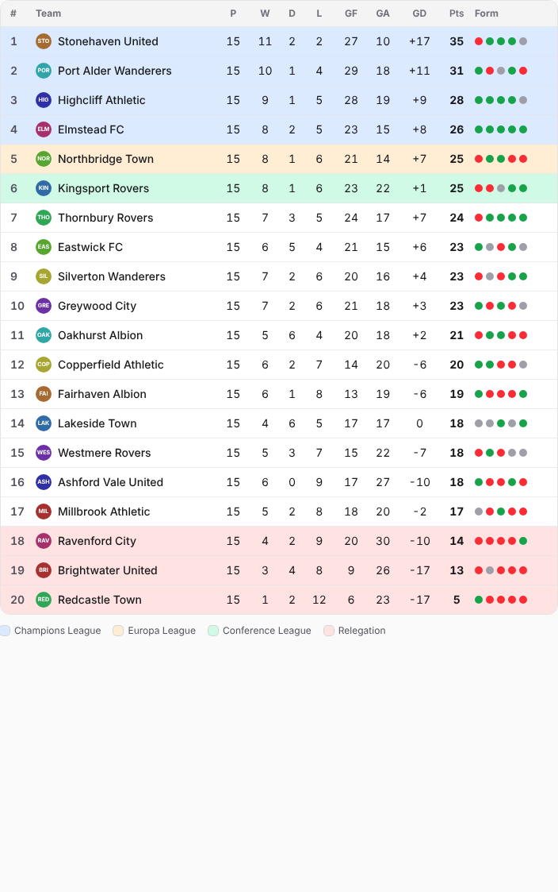

# Foot Simu

[footsimu.com](https://footsimu.com) is a free football simulator: a web platform for simulating real-world football leagues. Pick a league, see the current table and fixtures, then predict or simulate the remaining matches while the table updates live.

- **Phase 1:** league simulator for the Premier League, La Liga, Bundesliga, Serie A, Ligue 1 and Brasileirão Séries A, B and C. Available in EN, PT and ES. No accounts: progress is saved in the browser and can be shared by link.
- **Phase 2:** career / mini-game mode. Users pick leagues and play through their own seasons.

## Stack

Next.js 16 (App Router) + TypeScript, Tailwind CSS 4, next-intl and Zustand, hosted on Vercel. Phase 1 has no database: pages read the data feeds directly and cache them for an hour. Postgres arrives in phase 2 with accounts. Real fixtures and results come from ESPN's public site feed (no key needed; unofficial, so it may change without notice) — see `src/lib/espn.ts`. ESPN doesn't publish round numbers, so rounds are rebuilt from kick-off dates, keeping each league to its real number of rounds. [football-data.org](https://www.football-data.org/) (free tier) is the fallback when ESPN fails; Brasileirão Série B and MLS aren't in its free tier, so they have no fallback. MLS is shown as two conference tables (East/West, membership from ESPN's standings feed), with fixtures grouped by calendar week since it has no fixed rounds; set `groups` and `weeklyRounds` in the league config for that. Either way visitors never see made-up clubs. The site footer credits football-data.org only; ESPN's feed has no attribution terms. Each league's ESPN feed (`espn`) and `espnOnly` are set in `src/config/leagues.ts`. Cups (the FA Cup) live in `src/config/cups.ts`: each round's pairings come from ESPN once drawn, undrawn rounds get a deterministic simulated draw (`src/engine/cup.ts`), and clubs are rated from their own league's results scaled by division (`src/engine/cupModel.ts`).

### First-party league: Brasileirão Série C

ESPN has no 2026 Série C (`bra.3` stops at 2025) and football-data.org doesn't carry it, so Série C (`BSC`, `/brasileirao-serie-c`) is the site's own data: `firstParty` in its config, no `espn` feed. `scripts/import-serie-c.ts` imported it once from the CBF (cbf.com.br: the phase pages' official tables, the games API those pages load every round's games from, and each club's crest) into `src/data/serie-c/2026.json` and `public/crests/serie-c/{CBF club id}.jpg`, both committed; `src/lib/firstParty.ts` turns the file into the league's data. Loading the league, its pages or its crests never calls the CBF, ESPN or anyone else, sample data or not (`FOOTSIMU_SAMPLE_DATA=1` still shows the real Série C), and the revalidation route, the odds snapshots and the priors script have no feed to ask for it. Clubs carry the names the CBF's regulation (REC 2026) gives them ("Maringá", "Ituano", "Botafogo-PB"), not the company names some listings use ("Maringá FC SAF"); `cbfName` in the file keeps those.

The 2026 format, from the config (`split` with named `places`, `playoff` seeded `campaign`): a first phase of one round robin (19 games; wins, goal difference, goals scored, then fewer red and yellow cards, the data's `fallbackOrder`); its top 8 play two groups of 4 (the CBF's groups B: 1st, 4th, 5th, 8th and C: 2nd, 3rd, 6th, 7th), home and away from zero points, each group's top 2 promoted to Série B; the group winners play a two-legged final, the better campaign over both phases hosting the second leg, level on aggregate going straight to penalties; the first phase's bottom 2 go down to Série D. The groups always follow the first phase's table, predictions included: change a first-phase result that moves a club into or out of the top 8 and that group's games become new ones to play (the other group keeps its real games), and the final follows the groups. Club pages, the share card and the season's chances rank every club as the CBF's final classification does (`stagedClassification`: champion, runner-up, the runners-up by campaign, the rest of the groups by campaign, then the first phase). A finished real season shows "Replay season" next to "Simulate rest of season": every game, the groups and the final played again from the ratings (undoable), and any score can still be typed in. `src/lib/serieC.test.ts` rebuilds the CBF's first-phase and group tables from the committed games and checks the final, the promoted and the relegated clubs.

## Deploy

Production runs on Vercel at footsimu.com. See [docs/DEPLOY.md](docs/DEPLOY.md) for the step-by-step setup (domain, environment variables, Google Search Console).

## Run locally

Requires **Node.js 22.18 or newer** (`node -v`).

```bash
git checkout claude/youthful-lamport-0m3vrq
```

```bash
npm install
```

```bash
npm run dev
```

Open http://localhost:3000. You'll be redirected to `/en`; `/pt` and `/es` work too.

Every league loads from ESPN's feed, with or without an API key. Generated sample leagues with fictional team names are only used when no source can be reached (e.g. offline) in local development, or when `FOOTSIMU_SAMPLE_DATA=1` is set (the e2e test uses this). A production build on Vercel fails instead of publishing sample data, so the previous deployment stays live. To add football-data.org as the fallback source:

1. Get a free key at https://www.football-data.org/client/register
2. Copy `.env.example` to `.env.local` and set `FOOTBALL_DATA_API_KEY=your-key`
3. Restart `npm run dev`

Real data is cached for an hour, which stays well inside the free tier's limit of 10 requests per minute.

### Renaming clubs

To show a different name than the one football-data.org sends (for example "CA Paranaense" → "Athletico Paranaense"), add an entry to `src/config/teamOverrides.ts`:

```ts
{ match: "CA Paranaense", name: "Athletico Paranaense", shortName: "Athletico-PR", tla: "CAP" },
```

`match` is the club's name as the API sends it (case-insensitive) or its football-data.org team id. `name` is shown in the table, `shortName` in fixtures and on phones, `tla` in the badge; `crest` can replace the crest image. Only what you set changes.

## SEO

Each league × language page is pre-rendered with:
- Keyword-targeted titles and descriptions ("Football Simulator", "Simulador de Futebol", "Simulador do Brasileirão", "Premier League Simulator"…), set per language in `messages/*.json` (`Metadata`, `Seo`, `Faq`).
- Canonical and `hreflang` links (`en`, `pt-BR`, `es`, `x-default`), Open Graph and Twitter cards with generated images (`opengraph-image.tsx`).
- JSON-LD structured data: `WebSite`, `Organization`, `WebApplication`, `BreadcrumbList` and `FAQPage`.
- Crawlable intro, "how it works" and FAQ content, plus internal links between all league simulators.
- `sitemap.xml`, `robots.txt`, web manifest and icons.

Every club of every domestic league also has its own page, `/{locale}/{league}/team/{slug}` (slugs from `src/lib/clubs.ts`: lowercase, accent-free, unique within the league). It shows the club's position, points and form, its chances from the same Monte Carlo as the league page (10,000 seasons, real results only, see `src/lib/clubOutlook.ts`) and, in a league with a play-off after its table (the EFL, Segunda, Serie B, Série B, Ligue 2 and Eerste Divisie promotion play-offs, the MLS Cup, Liga MX), its chance of winning it and of reaching the final (each simulated season plays the league's own bracket from `src/config/leagues.ts`; promotion in the headline then counts every route: the automatic places, the play-off, and Serie B's 3rd going up directly when far enough clear). The knockout draws come from their own seeded stream, so playing it leaves every table chance, snapshot and report exactly as it was; its finishing-position spread, every remaining game with win/draw/loss odds, the toughest and must-win games and a templated summary (`Club` messages). Each page has its own title, description, canonical and `hreflang` links, a `SportsTeam` JSON-LD block and a card image (`team/[teamSlug]/opengraph-image.tsx`), which the page shows under its chances with a share menu (`ShareCardBlock`; the header has the share menu too). Pages render on first visit and refresh hourly (ISR), and all of them are in the sitemap. Club names in the tables and fixtures link to them.

Each domestic league also has chance pages that answer one search each (`src/lib/chancePages.ts`, words in `src/lib/chanceText.ts` and the `Chances` messages):
- `/{locale}/{league}/chances/{title|promotion|playoffs|relegation}`, for the outcomes the league has ("Premier League 2026/27 title odds"): every club's chance, likeliest first.
- `/{locale}/{league}/team/{slug}/chances/{outcome}` ("Arsenal's chances of winning the Premier League 2026/27"): the club's chance, where it stands, its likely finish and the race around it.

The title is the table's, or the play-off's where that decides the champion (the MLS Cup). Each page has an FAQ (`FAQPage` JSON-LD), a breadcrumb, canonical and `hreflang` links, the league's or the club's card, and links to the simulator, the club page and the other chance pages; the league and club pages link to them. They read the shared outlook like the club pages (no maths of their own) and refresh hourly (ISR). A club's page is for search engines only while the outcome is still open for it (1% to 99%); settled ones (0%, 100%, or a finished season) are `noindex`. The sitemap lists the league pages while the season is on, and each club's while open in the league's latest odds snapshot (it reads the snapshots rather than simulating every league).

Every league game also has a preview page, `/{locale}/{league}/match/{home}-vs-{away}-{yyyy-mm-dd}` (club slugs, and the date in the league's own time zone from `src/config/timezones.ts`; a game moved up to 21 days redirects to its new address, any other date is a 404). It shows the date, kick-off (in the visitor's time zone once loaded) and ground, the match model's win/draw/loss chances, expected goals and five likeliest scores, a dice roll (`sampleLikelyScore`), both clubs' form and places, and "What this result means": the season's Monte Carlo rerun with each result fixed (the likeliest home win, draw and away win scores), with the same draws for every other game, so the change in each club's chances is the result's alone (`resultScenarios` in `src/lib/clubOutlook.ts`, cached per game). Once the game is played the page stays: the final score on top and the odds the model gave at kick-off, labelled "Pre-match prediction" (the model rebuilt from the results before it). Pages refresh hourly, and every 10 minutes on match day (the game's own state is fetched from ESPN). Games from the past 30 days to the next 14 (`inIndexWindow` in `src/lib/matches.ts`) are in the sitemap and linked from club pages; other games' pages load but send `noindex, follow`. Every league game's row on the league page has a chart button to its preview, next to the dice. Each page has its own title, description, `hreflang`, a `SportsEvent` JSON-LD block and a card image.

### Odds reports ("what changed")

Each domestic league has a report per completed round, `/{locale}/{league}/odds/matchday-{n}`, and `/{locale}/{league}/odds` shows the latest with links to the earlier ones; `/{locale}/odds` ("Latest odds" in the menu) lists every league's latest. A report compares the round's snapshot with the previous one (`src/lib/oddsReports.ts`): the three biggest risers and fallers for the title, the top continental competition (its qualifying round included), promotion or the play-offs, and relegation; every club's chances with the change in points; the game whose two clubs' chances moved the most; the top five's chances across the season (`RaceChart`, with a table view); and short sentences from the `Odds` messages, with each club's result. When the previous report was taken with another model (see Odds snapshots), the report says so and shows no changes, movers or result of the round that week. Each has its own title, description, `hreflang`, an `Article` JSON-LD block dated to the round and a share card (the race after the round). Each report with changes also has a biggest-movers card, `/{locale}/{league}/odds/matchday-{n}/movers-image` (a 1200×630 PNG, `moversCardImage` in `src/lib/oddsCard.tsx`): up to three races (the title, promotion and relegation first, then the continental places and the play-offs) with each one's two biggest risers and fallers (`moversCardSections` in `src/lib/oddsReports.ts`; ties go to the higher chance now, then the higher place, then the club id, as on the page). It's shown, with its share menu, under the report's "Biggest risers and fallers"; a round's report never changes, so the CDN keeps the card like the other share cards. It is an image, not a page, so it isn't in the sitemap. They're built from the snapshot files, so a new round's report appears as soon as the snapshot job's commit is deployed. With sample data they come from the sample leagues' own rounds.

### Shared outlook (league and club pages agree)

A league's page, every one of its club pages and their images show chances from the same simulated seasons: the Monte Carlo runs once per league, data version and `SIM_VERSION`, and its counts are kept in Next's data cache (`unstable_cache`, `src/lib/sharedOutlook.ts`), which every server instance reads and which outlives a deployment. So a league's club pages always add up (one champion, two promoted…), and a cold server reads the run instead of working it out again. Each page that reads it is tagged `league:<CODE>-outlook` (and its ESPN data `league:<CODE>`).

The pages still rebuild on their own every hour, so after new results some could show the new table and others the old one. `/api/revalidate/leagues` closes that gap: it compares each domestic league's ESPN data now with the cached copy and, when they differ (or a game kicked off in the last four hours), revalidates both tags, so every page of the league is rebuilt from the new data on its next visit. `.github/workflows/revalidate-leagues.yml` calls it every 30 minutes. It only answers with a token: set `REVALIDATE_TOKEN` to the same random value in the Vercel project's environment and as a GitHub repository secret (`SITE_URL`, a repository variable, overrides `https://footsimu.com`). Without them the job does nothing and pages refresh hourly as before. By hand: `curl -H "Authorization: Bearer $REVALIDATE_TOKEN" https://footsimu.com/api/revalidate/leagues?league=PL`.

MLS club pages need ESPN's conference standings: they're retried, and the last ones ESPN gave are kept in the data cache for an hour at a time, so a busy moment at ESPN doesn't fail every MLS page. Club pages (and their images) can run for up to 60 seconds, as match pages can.

### Odds snapshots

After each completed round of each domestic league, every club's season chances (title, each place, relegation, expected position and points) are stored in `src/data/snapshots/<CODE>.json`, one line per round, by season. `.github/workflows/odds-snapshots.yml` runs `npm run snapshots` (`scripts/snapshot-odds.ts`) every six hours and commits any new snapshots to `main`; run it by hand from the Actions tab (Run workflow) or locally with `npm run snapshots` (`-- PL BSA` for some leagues, `-- --dry-run` to only print).

A round counts once it and every round before it are played (a game postponed far from its round's dates isn't waited for), and its snapshot is taken as of just after its last kick-off: later results are left out, so a late run records the same numbers. Rounds are taken in the order they were played and numbered by how many are complete (rounds are rebuilt from dates, and a few hold games scattered over months). A season's first run stores only the latest round; after that, every newly completed round. `npm run snapshots -- --backfill` also adds every earlier completed round not stored (split leagues whose groups are already known start at the split, so a snapshot never knows who went where); the current season was backfilled that way. `npm run snapshots -- ELC --rebuild` takes a league's stored rounds of the season again with today's engine, each as of its own moment (the Championship was rebuilt so with the rating-noise model). Each snapshot carries the model it was taken with (`modelVersion`, the `SIM_VERSION` then; none before the field: model "1"): the first report after a model change, the race chart and the projected table's round-by-round history label that step as a model update instead of showing it as movement.

**Drift check.** `npm run snapshots:check` (`scripts/check-snapshots.ts`; `-- PL ELC` for some leagues) takes every league's latest stored snapshot of its current season again with the live engine (the same moment, iterations and model; model "1" is today's engine without rating noise, see `REPRODUCIBLE_MODELS` in `src/lib/snapshots.ts`) and compares every club's table row, chance of each place, expected place and points, and projected place. Snapshots are rounded to 4 decimals from a seeded run, so the two must match exactly (`DRIFT_EPSILON` = 0). A drift means the stored history no longer matches what the engine says about those rounds: the engine changed without a `SIM_VERSION` bump, ESPN corrected a result, or a game's xG arrived after its round was taken. To refresh one league, retake its season with `npm run snapshots -- BL1 --rebuild` (or bump `SIM_VERSION` when the model changed on purpose, so new rounds are labelled). Leagues whose ESPN data doesn't load are skipped, not failed. `.github/workflows/snapshot-drift.yml` runs it on changes to the engine, the outlook, the league config or the data, and daily. Committed JSON was chosen over Vercel Blob or a KV store: no service, token or quota to set up on Vercel Hobby, the history is versioned and reviewable in git, and pages read it from the deployment itself. Each commit redeploys the site (a few per week).

After deploying, set `NEXT_PUBLIC_SITE_URL` to the live domain and `NEXT_PUBLIC_GOOGLE_SITE_VERIFICATION` to your Google Search Console code, then submit `/sitemap.xml` in Search Console.

### My World

`/{locale}/my-world` (PT "Meu mundo", ES "Mi mundo") is a game mode, a fictional timeline of the English pyramid: the visitor picks a club from the Premier League, the Championship, League One or League Two and plays season after season of all four leagues, so a League Two club can be taken up to the Premier League. It is linked from the menu and the home page and is in the sitemap; `MY_WORLD_LISTED` in `src/lib/site.ts` unlists it (no links or sitemap entries, not indexed, the page still working at its address), as while it was reworked. Everything is in `src/lib/myWorld.ts` (pure, tested), played in the browser:

- **The start.** The page passes the four leagues' live data (`worldStartPack`, `src/lib/myWorldStart.ts`): clubs, results so far, the games left, deductions, any play-off games played, and the same ratings the site's season odds use (the outlook's model). The world's first season finishes the real one. A league whose data doesn't load means no new world for now; a saved world doesn't need the live data.
- **Playing a season, league by league.** The world starts from the leagues as they are and is the player's from then on: no real result is ever synced in. Each league is played exactly as on the league pages (`FixtureList`, without the match-preview links and the kick-off times, which a fictional calendar doesn't have): its table and fixtures matchday by matchday, score boxes and a dice per game, "Simulate matchday", "Simulate rest of season" (that league and its play-off), Undo and Reset (that league's season), the play-off ties and the promoted clubs. The dice make a likely roll, as there; "Simulate matchday" and "Simulate rest of season" draw each score from the full distribution, from the season's form, as a whole season is drawn, so the tables look like real ones (champions on about 70–100 points, the bottom club on about 15–35, season after season). Likely rolls never let a club win a game it has under a one-in-five chance of winning, so over a whole season they made 106-point champions and 9-point bottom clubs, and carried into the next season's ratings, worse each season. Even the results the first season started with can be changed, and typing one back in leaves it as it was. Play-off scores belong to their pairing, as on the league pages: a league or earlier-round score that changes who meets whom clears that tie's scores. The club card counts the games left in each league (play-off games and a level tie's shoot-out included; a league's count opens its fixtures), and once every league is played, "End season" ends it (promotion and relegation) and shows its review; the review's "Start next season" (its bottom-right corner) opens the next season's tables and fixtures, hidden until then. Each season's form (its rating noise) is drawn once from the world's seed.
- **Past seasons.** The season picker, on the left of the league's buttons (above the table on phones), shows any finished season instead of the current one: every league's final table, with who were champions, promoted, in the play-offs or relegated, its play-off final, and every result matchday by matchday and its play-off ties, nothing to change. Each finished season keeps its results packed in five characters a game (`SavedDivision.games`, `packGames`) and its play-off's scores (`SavedDivision.playoff`), for the last `FIXTURE_SEASONS` (50) seasons; older ones keep their final tables.
- **A season.** All four leagues are played with the site's own engine: each remaining game's score from the club ratings (Dixon–Coles, as the season outlook draws them, with the same season rating noise, `SEASON_RATING_NOISE`), the table with the league's tiebreakers and deductions, and the league's own play-off (`simulatePlayoff`). Then promotion and relegation are applied together, from the league configs (`zones` and the play-off winner): 3 between the Premier League and the Championship, 3 between the Championship and League One, 4 between League One and League Two. League Two's 2 relegated clubs drop into the National League for a season, and its 2 clubs come up in their place: Boreham Wood and Harrogate Town (real clubs, with their ESPN crests, `src/config/nationalLeague.ts`) after the first season, then each season the clubs relegated the season before; Boreham Wood and Harrogate Town go back down only if they're relegated. No fictional clubs (worlds from before the National League keep the ones they had). Later seasons are new double round robins in a new order each season, with a real league's home-and-away rhythm (`balancedDoubleRoundRobin`, `src/engine/schedule.ts`): no club ever plays three games in a row at home or away, and each has at most one home-home or away-away pair per half (calendar 2; a season already being played on the first calendar keeps it until it's finished, so its scores stay with their games). Season labels follow the English split year (2026/27, 2027/28…). A world's seed makes each of its seasons reproducible.
- **Ratings between seasons.** Each club's rating carries into the next season through the site's own between-season rule, the one the real starting ratings are built with (`src/engine/offseason.ts`, shared with `scripts/priorsLib.ts`): its rating from the season's results keeps 75% of its difference from average, a promoted club becomes a below-average one in its new league, a relegated club the reverse, and a club up from the National League starts at `NO_DATA_PRIOR` (below average). Each division's goal rates and rho stay those of the live model. None of it touches the live outlook, the odds snapshots or `SIM_VERSION`.
- **The save.** One world per browser, in localStorage (`footsimu:my-world`, `src/lib/myWorldStorage.ts`), written after every step (every score typed in, rolled or simulated): the clubs (those that left too), the ratings, the season in progress with its scores so far (`DivisionSeason.scores`) and every finished season's final table of every league (played, won, drawn, lost, goals, points, and who were champions, promoted, in the play-offs or relegated, with the play-off final) and its results. A new world is about 60 KB (the real season's calendar); later on about 12 KB plus 14 KB a finished season (3 KB once its results are no longer kept), and up to about 40 KB more for the scores of a season in progress. Undo is for this visit only. A save from another version (`WORLD_VERSION`) or one that can't be read is set aside and a new world starts; without storage (private browsing) the world plays unsaved, with a note.
- **The page.** Set up (a league, a club, create), then the club and the season, with the games left in each league and "End season" once they're all played; the country (England, the only one so far, before the season's heading), every league's table and fixtures, and the season picker; the season's review (the club's result, the champions, who went up and down, who left and who came in), then "Start next season". Any club's path, picked by country (England, for now), league and club (the visitor's club to begin with; a club in the National League listed under its last league), the latest season first: each season's league, place and outcome (champions, promoted, the play-offs' winners, the play-offs, relegated, a European place from the league's zones (Champions League, Europa League, Conference League), the neutral zone, or a season in the National League). A new world asks first. The live league pages and their dice simulator are unchanged (the fixture list only gained an option to leave the kick-off times out).

### Ad slots (off)

Reserved placements for display ads, for once the AdSense review is over (`src/lib/adSlots.ts`, `src/components/AdSlot.ts`): one in each league page below the simulator and its projected table, and one in each club page after its finishing positions. Each keeps the exact size of its ad, a 300×250 rectangle on phones and a 728×90 leaderboard from 768px up (a 300×600 desktop rail is defined, not placed), so a filled ad never moves the page.

- **Off by default** (`NEXT_PUBLIC_ADS_SLOTS` unset): a slot renders nothing, so the site is exactly as without them. That's chosen over an empty reserved box while the site is under review, so visitors see no blank gaps. The flag is a build setting, so the layout changes between deployments, never while a page loads.
- **On** (`NEXT_PUBLIC_ADS_SLOTS=1`, with `NEXT_PUBLIC_ADSENSE_CLIENT` and the slot's ad unit id `NEXT_PUBLIC_ADS_UNIT_IN_CONTENT`): the box with its `<ins class="adsbygoogle">`, filled by the Auto ads script the layout already loads. Slots add no script, and `ads.txt` and that script are unchanged. Without the publisher id or the unit, the slot is the empty box at its size.
- **`NEXT_PUBLIC_ADS_DEBUG=1`**: the box is outlined and labelled "Ad", to check the layout on a preview before any ad is live.

To check a flagged build, run the e2e suite with `E2E_ADS=1` against a build with `NEXT_PUBLIC_ADS_SLOTS=1`. It measures each box (300×250 on a phone, 728×90 on desktop) and fills it with an ad of that size, checking that nothing below moves.

### Daily quiz

`/{locale}/quiz` ("Quiz" in the menu, and a card on the home page) asks six questions a day, picked from the UTC date and the language alone (`dailyQuiz` in `src/lib/quiz.ts`), so everyone playing in a language that day gets the same set; leagues come up by how much each language's visitors follow them. Four are about past seasons, one of each kind (who won it, who finished second, which of four was relegated, which of two finished higher), from `src/data/history.json`: the final tables of the leagues whose table decides the champion, from 2015/16 on. Two ask which of two clubs is likelier to win the title, reach the top place (a continental competition or promotion) or go down this season, from the shared outlook of two leagues picked for the day (`src/lib/quizPage.ts`); the chances are shown only once answered. When a league's season is over, its live question is replaced with one from the past. Answers stay in the visitor's browser for the day; the score can be shared as text. The page is rebuilt every 15 minutes, so a new set appears shortly after midnight UTC. `npm run history` (`scripts/build-history.ts`) rebuilds the dataset from ESPN's final standings (relegated clubs from ESPN's notes, or the league's relegation places when a season has none); run it once a season has ended.

### Other commands

| Command | What it does |
|---|---|
| `npm run build && npm start` | Production build and server |
| `npm test` | Engine and library unit tests |
| `npm run typecheck` | TypeScript check |
| `npm run snapshots` | Add odds snapshots for newly completed rounds (real data; see Odds snapshots) |
| `npm run history` | Rebuild the quiz's past final tables (`src/data/history.json`) from ESPN (real data; see Daily quiz) |
| `npm run snapshots:check` | Check that the live engine reproduces every league's latest stored snapshot (real data; see Odds snapshots) |
| `npm run test:e2e` | Browser test against a running server built and started with `FOOTSIMU_SAMPLE_DATA=1` (`FOOTSIMU_SAMPLE_DATA=1 npm run build && FOOTSIMU_SAMPLE_DATA=1 npm start`: share pages and cards render on request, so the server needs it too; needs Playwright: `npx playwright install chromium`) |

### Yearly: rebuild priors

The chances in domestic leagues start from `src/data/priors/<year>.ts`, built
from ESPN's results by `scripts/build-priors.ts` (logic in `scripts/priorsLib.ts`).
For each league it holds:

- **clubs**: each club's starting rating, from last season (promoted clubs from
  their rating in the league below, relegated ones the reverse, clubs without
  data a below-average default);
- **rho**: the Dixon–Coles dependence of low scores (negative means more 0–0 and
  1–1 than independent Poisson counts), by maximum likelihood over last season's
  and this season's games with the ratings held fixed, kept within −0.2..0
  (−0.10 for leagues with fewer than 150 games);
- **home**: each returning club's home/away split relative to the league's,
  from the same games, opponent-adjusted, shrunk to the league's
  (w = n / (n + 35), n its home games) and clamped to ±30%. Promoted clubs and
  clubs without data play at the league's home advantage; neutral grounds have none.

Rebuild it once a new season's clubs are on ESPN:

```bash
npm run priors -- 2027
```

This builds the season starting in 2027 (2027/28 for European leagues, 2027 for
calendar-year leagues such as the Brasileirão, MLS, J1 and the South American
leagues) and writes `src/data/priors/2027.ts` and `src/data/priors/index.ts`;
commit both. Calendar-year leagues start in January, so run it then for them, and
again in August for the European ones (leagues whose new season isn't on ESPN yet
are skipped with a warning). Until a season has its own file, the latest earlier
one is used and the server logs a warning, and `npm test` fails once the newest
file is more than one season behind any league's current season.

#### Match model switches and the backtest

`src/engine/ratings.ts` holds three switches, set from a backtest of last season:

| Switch | Now | Why |
|---|---|---|
| `DIXON_COLES` (score distribution with rho) | on | slightly better 1X2 log-loss and Brier score, draw rate close to the real one |
| `TEAM_HOME_ADVANTAGE` (the clubs' home splits) | off | worse in all four leagues tested |
| `RATING_HALF_LIFE` (recency weighting; `ratingHalfLife` per league) | off (`Infinity`) | every half-life from 6 to 40 games scored worse |

To re-run it (predicting each matchday of a past season from earlier games only,
with priors, rho and home splits from the season before):

```bash
npm run backtest -- 2025 PL PD SA BSA
```

#### Expected goals (xG)

ESPN's core API gives each club's `expectedGoals` in a game's team statistics
(`…/events/{id}/competitions/{id}/competitors/{team}/statistics`: the home side's
`offensive.expectedGoals` and `goalKeeping.expectedGoalsConceded`) for 14
competitions: Premier League, Championship, La Liga, Bundesliga, Serie A,
Ligue 1, Brasileirão, MLS, Argentina, Liga MX, Champions League, Europa League,
Conference League and Libertadores (`XG_LEAGUES` in `src/lib/xg.ts`). It starts
with the 2026 seasons (2026/27 in Europe; Argentina from its Clausura), so last
season, and the priors built from it, has none. `npm run xg` stores it per game
in `src/data/xg/<CODE>.json` by ESPN game id, `null` where ESPN has none (never
a 0), fetching only games not stored yet (two requests at a time, retries with
backoff); the odds snapshots job runs it every six hours before the snapshots.

A league's ratings can rate attack and defence on `w × xG + (1 − w) × goals`
for each game with xG (goals alone for the others), with
`ratingXgWeight` in `src/config/leagues.ts` (default `XG_WEIGHT`, 0: goals
only). Everything else (opponent adjustment, priors, Dixon–Coles, the league's
goal averages) stays on goals. The backtest of the 2026 season so far
(`npm run backtest -- 2026 PL ELC PD BL1 SA FL1 BSA MLS ARG MX --xg`, each
matchday predicted from earlier games),
1X2 log loss:

| League | Games | w = 0 | 0.3 | 0.5 | 0.7 | 1 |
|---|---|---|---|---|---|---|
| Premier League | 90 | **1.0391** | 1.0402 | 1.0414 | 1.0431 | 1.0463 |
| Championship | 168 | 1.0641 | **1.0639** | 1.0643 | 1.0651 | 1.0672 |
| La Liga | 109 | **0.9636** | 0.9662 | 0.9683 | 0.9707 | 0.9748 |
| Bundesliga | 72 | 1.0187 | 1.0157 | 1.0140 | 1.0125 | **1.0108** |
| Serie A | 100 | **0.8928** | 0.8979 | 0.9023 | 0.9076 | 0.9171 |
| Ligue 1 | 81 | 1.0067 | 1.0056 | **1.0052** | 1.0053 | 1.0059 |
| Brasileirão | 336 | 1.0169 | 1.0126 | 1.0105 | 1.0092 | **1.0084** |
| MLS | 496 | 1.0528 | 1.0496 | 1.0481 | 1.0471 | **1.0464** |
| Argentina | 480 | 1.0572 | 1.0567 | 1.0564 | 1.0562 | **1.0561** |
| Liga MX | 134 | 1.0800 | 1.0786 | 1.0782 | **1.0781** | 1.0788 |
| All | 2066 | 1.0346 | 1.0332 | 1.0328 | **1.0327** | 1.0334 |

Only the Brasileirão and MLS, with xG for a whole season's worth of games,
improve clearly (about two standard errors, game by game, on both log loss and
Brier score), so they rate on `ratingXgWeight: 0.5`. The European leagues have
ten rounds or so each, within noise, and three of them lean worse; they stay on
goals until there's more of the season to test.

#### Season-outcome backtest (is the Monte Carlo calibrated?)

`npm run backtest` scores single games. `npm run backtest:season` checks the
season chances: when the site says 30% for the title, does that happen about
30% of the time? It runs offline and changes nothing on the site.

```bash
npm run backtest:season -- 2025 PL ELC PD BL1 SA FL1 BSA MLS ARG MX
npm run backtest:season -- 2025 PL --rating-noise 0,0.05,0.1,0.15 --noise-k 18
```

For each league's finished season (`scripts/backtest-season.ts`), at checkpoints
after rounds 0 (starting ratings only), 5, 10, 15, 20, 25 and 30 of a 38-round
season (the same shares of the season's games for other lengths), it rebuilds
the model from the results played by then: starting ratings from the season
before (as `npm run priors`, without the season itself), xG only of games
already played at the league's live weight, no later results, play-off games
or deductions. Then it runs the site's own setup (tiebreakers, splits,
conferences, annual tables) for 10,000 seasons with seed 2026, and scores each
club's chances against the real final table:

- Brier score for the title, the top places (the league's main continental
  places, or promotion in a second tier), relegation and the play-off places;
- ranked probability score (RPS) of the whole finishing-position distribution;
- the mean absolute error of each club's expected finishing place;
- a calibration table: every chance in buckets (0–5%, 5–15%, 15–30%, 30–50%,
  50–70%, 70–90%, 90–100%), the average predicted chance against how often it
  happened and the count (fewer than 30: too few to trust), and the
  calibration error (the buckets' gaps, weighted by their counts);
- the same for a baseline: the table at the checkpoint is the final table (at
  round 0, last season's, promoted clubs below the others).

Lower is better for every score. The summary prints per league and checkpoint
and pooled; everything (with each club's distribution) goes to
`backtest-results/season-<season>.json` (not committed; `--out` for another
file). Leagues run side by side (`--jobs`, default the CPUs); the ten above take
about a minute and a half. A league whose season isn't finished, or whose format
ESPN didn't have then (Argentina 2024), is skipped with the reason. The places
come from today's league config.

`--rating-noise <sd,…>` reruns each checkpoint with rating uncertainty: every
simulated season starts with each club's attack and defence multiplied by
exp(N(0, s)), s = sd × √(k / (k + games played)), `--noise-k` k (default 18,
the prior's weight). It's an engine option (`ratingNoise` in
`runMonteCarlo`); each backtest run sets its own (`0`: none), whatever the
site uses. The site's season outlook has sd 0.15, k 5 (`SEASON_RATING_NOISE`
in `src/lib/seasonNoise.ts`, chosen by the grid below): the Chances tab, club
pages, match impact, share cards and odds snapshots of every domestic league
(continental competitions have none). A game's own odds (match pages) and the
dice come from the plain ratings and don't use it.

To tune it, run a grid of spreads and fade constants for each season (several
values for both flags: every spread with every k, plus no noise, keyed
`sd/k`), then pool the seasons:

```bash
npm run backtest:season -- 2025 PL ELC PD BL1 SA FL1 BSA MLS ARG MX --rating-noise 0,0.15,0.2,0.25,0.3 --noise-k 5,10,20,40
npm run backtest:season:tune -- 2022 2023 2024 2025
```

The second reads `backtest-results/season-<season>.json` for each season,
scores every run on all of them together and applies the selection rule: the
lowest pooled RPS, as long as its calibration error is no worse than no
noise's at any checkpoint by more than 0.002, its title Brier is no more than
1% worse, and it beats no noise. It prints Markdown tables (each checkpoint for
no noise, the chosen run and the runner-up; each season apart; the whole grid)
and writes them to `backtest-results/rating-noise-tune.md` (numbers in
`rating-noise-tune.json`). A grid of 17 runs takes a few minutes per season.

What it found (four seasons, 2022–2025: 35 league seasons, 736 clubs per
checkpoint; not loaded: Argentina 2022–2024, whose ESPN tables then had
another format, and the Championship and La Liga 2022, where ESPN has no
results for 11–15 February 2023):

| Round | RPS, no noise | sd 0.15, k 5 | sd 0.25, k 20 | calibration error, no noise / sd 0.15, k 5 |
|---|---|---|---|---|
| 0 | 0.147 | 0.141 | 0.140 | 0.043 / 0.025 |
| 10 | 0.105 | 0.104 | 0.103 | 0.018 / 0.011 |
| 20 | 0.077 | 0.076 | 0.076 | 0.010 / 0.008 |
| 30 | 0.051 | 0.051 | 0.051 | 0.006 / 0.006 |

- The model beats "the table as it stands" on RPS at every checkpoint of every
  season.
- Without noise it is overconfident, most of all early in the season (the
  calibration error is 0.043 at round 0, 0.017 over all checkpoints).
- Every pair of the grid improves RPS and calibration over no noise in all
  four seasons, most with a wider spread (best: sd 0.25, k 20, RPS 0.0917
  against 0.0940, calibration error 0.004). But they all make the title
  chances worse (title Brier +1.3% to +12.6% pooled): noise takes chances away
  from the favourites, and the favourites mostly won, most of all in Ligue 1,
  the Premier League and the Championship.
- Only sd 0.15, k 5 meets the selection rule (title Brier +0.8%): pooled RPS
  0.0926, calibration error 0.010, better than no noise in each of the four
  seasons. It sits at the grid's corner (the smallest spread, the fastest
  fade: s = 0.15 at the start of the season, 0.067 after 20 games). It is
  the site's season outlook since roadmap item 4 (`SIM_VERSION` "2").



## Project layout

| Path | Purpose |
|---|---|
| `src/app/[locale]/` | Home page and `[league]` simulator page (pre-rendered, refreshed hourly) |
| `src/components/` | `LeagueSimulator`, `StandingsTable`, `FixtureList`, `ProbabilityGrid`, header/footer |
| `src/store/simStore.ts` | Predictions per league and season, saved in the browser, with undo |
| `src/workers/montecarlo.worker.ts` | Runs the 10,000-season simulation off the main thread |
| `src/lib/leagueData.ts` | Loads ESPN data, falls back to football-data.org, or the sample league in local development |
| `src/lib/shareCodec.ts` | Compact URL encoding of predictions for share links (nothing is stored: the prediction is the link) |
| `src/app/[locale]/[league]/share/[code]/` | Share page (the predicted table, read-only) and its 1200×630 card (`opengraph-image`, `twitter-image`), drawn by `src/lib/shareCard.tsx` from `src/lib/scenario.ts` |
| `src/config/leagues.ts` | Tiebreakers and qualification/relegation zones per league |
| `src/i18n/`, `messages/` | Routing and translations (EN, PT, ES) |
| `src/engine/` | Framework-free simulation engine (see below) |

### Simulation engine

`src/engine/` is plain TypeScript with no framework dependencies, so phase 2 can reuse it on the server.

| Module | Purpose |
|---|---|
| `rng.ts` | Seeded PRNG (mulberry32). The same seed always gives the same simulation. |
| `ratings.ts` | Attack/defence strengths from played matches, adjusted for the opponents' strength and shrunk toward a prior (last season's ratings, see "Yearly: rebuild priors") early in the season |
| `match.ts` | Expected goals per fixture, Poisson score sampling, and exact home/draw/away probabilities |
| `standings.ts` | League table with per-league tiebreakers (including head-to-head mini-leagues) and points deductions |
| `montecarlo.ts` | Simulates the rest of the season N times to get the probability of each final position (with rating noise for the season outlook: each simulated season redraws every club's strength around its rating, see `src/lib/seasonNoise.ts`) |
| `schedule.ts` | Double round-robin fixture generator (sample leagues, tests, phase 2) |

Data provided by football-data.org.
